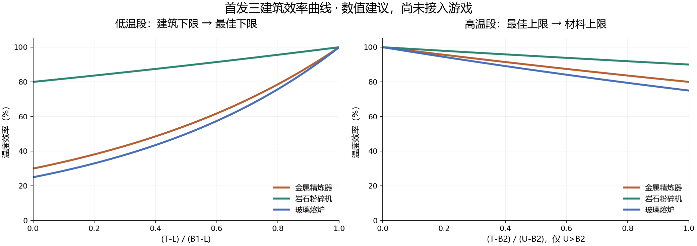

# 工业首发三建筑数值设计

2026-10-14。首个正式版范围已由用户确认：**金属精炼器、岩石粉碎机、玻璃熔炉**。岩石粉碎机**不设内置加热，强制仅解除温区限制，升温依靠生产自热或外部热源**，也是本轮用户明确确认的规则。

本篇交付配方、温区、效率系数、启动与回差、电热、材料可达性、磨损和维修的完整首发数值初稿。它取代旧十三建筑草案在**这三栋建筑上的数值建议**；其他建筑不纳入首发，不顺带接入电力、房间或辐射新系统。

**数值性质：** 已确认值保持不变；其余表项是本轮给出的首发建议初值，尚未由游戏平衡验收定案。用户随后要求“进行修改”，已授权将本表初值接入 v0.2.0 代码；这代表实施授权，不代表游戏平衡验收定案。**v0.2.0 已实现并完成离线验证，2026-10-15按用户要求部署；实际安装已为v0.2.0，未运行新版游戏或平衡验收。**

## 1. 数据依据和全量范围

本轮定向核对实际安装的 `E:\SteamLibrary\steamapps\common\OxygenNotIncluded\OxygenNotIncluded_Data\Managed\Assembly-CSharp.dll` 中：

- `MetalRefineryConfig.CreateBuildingDef / ConfigureBuildingTemplate`、`LiquidCooledRefinery.SpawnOrderProduct`：动态金属配方、钢、冷却液与配方热量。
- `RockCrusherConfig.CreateBuildingDef / ConfigureBuildingTemplate`：制砂候选、金属回收、壳类及 DLC 配方。
- `GlassForgeConfig.CreateBuildingDef / ConfigureBuildingTemplate`、`ComplexFabricator.SpawnOrderProduct` 的 `Melted` 分支：制玻璃配方与元素默认输出温度。
- `TUNING.BUILDINGS.CONSTRUCTION_MASS_KG.TIER5`、`TUNING.MATERIALS`、`BuildingTemplates.CreateBuildingDef`：建造质量、建材标签、生命值及有效温度质量。
- `Repairable.SMInstance / OnWorkTick`、`BuildingHP.Repair`、`Overheatable.TryDoOverheatDamage / ResetTemperature`：维修成本与原版过热行为。
- 安装目录 `OxygenNotIncluded_Data\StreamingAssets\elements\solid.yaml / liquid.yaml / gas.yaml / special.yaml`：元素相变、标签、硬度、比热和导热。

`E:\ONI-Ref` 保持只读；不依据旧参考文件推断整个游戏版本。本机静态定义对应 **40 个配方候选：金属精炼器 13、岩石粉碎机 26、玻璃熔炉 1**。岩石粉碎机的制砂替代原料是一条候选集合配方，不把每种原料重复计成独立配方。

此数是安装 DLL + 静态元素的候选核对，不是本轮已经在游戏里枚举的已注册数量。DLC 未启用、禁用元素与预制件可用性会影响实际列表；v0.2.0 接入在 `ComplexRecipeManager.PostProcess` 之后核对真实注册表，正常跳过不可用项，不创建原版不存在的配方。

联网补充尝试了 [金属精炼器](https://oxygennotincluded.wiki.gg/wiki/Metal_Refinery)、[岩石粉碎机](https://oxygennotincluded.wiki.gg/wiki/Rock_Crusher)、[玻璃熔炉](https://oxygennotincluded.wiki.gg/wiki/Glass_Forge) 页面，正文均返回 403；没有据此声称读过页面。以下原版数字以本机程序集和元素文件为依据。

## 2. 建筑级数值与保留的规则

温度对象为建筑本体；配方只定义最佳区 `[B₁,B₂]`。建筑下限 `L` 按类型确定；上限与过热阈值共用 `U_K = 0.75 × 主建造材料熔点(K)`，显示摄氏度时 `U = U_K − 273.15`。不能把摄氏熔点直接乘 0.75。

建材按原版类别选择，不开放新材料类别。所有数字中的生产时间是**温度效率 100%、操作速度倍率 1** 时的基准；保留复制人属性倍率。

| 建筑 / prefab id | L（℃） | 建材类别 | 生产功率 W | 原版生产自热 kW | 建造质量 kg / 有效温度质量 kg | HP | 内置加热 |
| --- | --- | --- | --- | --- | --- | --- | --- |
| 金属精炼器 `MetalRefinery` | 80（已确认） | `BuildableRaw` | 1200 | 16 | 800 / 160 | 30 | 有；沿用共用滑条 |
| 岩石粉碎机 `RockCrusher` | −20（建议） | `Metal` | 240 | 16 | 800 / 160 | 30 | 无（用户已确认） |
| 玻璃熔炉 `GlassForge` | 80（建议） | `BuildableRaw` | 1200 | 16 | 800 / 160 | 30 | 建议接入共用滑条 |

除两个新增建筑下限和玻璃熔炉内置加热接入外，上表功率、自热、质量、生命值与材料类别均沿用本机原版。三栋都是复制人操作的批次设备，不因接入 Mod 改成自动生产。

- 金属精炼器与玻璃熔炉使用相同建筑下限，不要求配方最佳区也相同。玻璃的高温收益由最佳区与低温效率惩罚体现，允许先低效启动，再经营高温工厂。
- 岩石粉碎机下限 −20 ℃、最佳下限 15 ℃，默认启动 −16.5 ℃；常见常温环境可以直接开工，低温环境也留有默认低效路线。没有内置加热时，控制模式冷启动不足只能等外部升温或由强制生产自热升温。
- 原版生产自热 16 kW 只在真实生产活动时发生，不在纯预热、等待、暂停或损坏期间发生；不乘内置加热倍率。
- 默认模式允许已开工设备在 `[L,U]` 工作；控制模式仅允许 `[B₁,min(B₂,U)]`。强制覆盖温度停机，其他生产条件仍有效。
- 温区输出只报告锁定配方最佳区，绿色不等于正在生产；输入红信号不阻止有效批次的内置加热。
- v0.1.3 的过热受损停热继续有效：首次实际过热扣血停止内置加热及其需求，完全维修解除；切强制、换单、降温和读档不清保护。岩石粉碎机没有这部分加热功率，强制不会凭空产生加热器。
- 对已经登记最佳区的配方应用上述温控；异常或未配置项按现有兼容口径退回原版并留日志，不扩大到其他 Mod 的所有新增配方。

## 3. 金属精炼器：全部配方候选

原版每批基准时间均为 **40 s**，冷却液要求 **400 kg**，生产功率 **1200 W**。除钢外，输入均为表中矿石／导热质 **100 kg**；不修改原版收率、投入与产物。

表中的两条启动线是**未受材料上限截断的原目标**。实际目标取 `min(原目标,U)`；最佳区是否可达须另看建材。`λ_L` 单位为 `K⁻¹`，用于 §6 的指数效率，不是温区边界。

| 输入识别 | 输入 kg | 输出 kg | 最佳区 ℃ | 默认原目标 ℃ | 控制原目标 ℃ | 完整交集控制回差 K | λ_L | A_L（K式） |
| --- | --- | --- | --- | --- | --- | --- | --- | --- |
| `Cinnabar` | 朱砂 100 | 汞 100 | 140–240 | 86 | 150 | 5 | 0.02006621 | 0.0002509251 |
| `Galena` | 方铅矿 100 | 铅 87 + 硫 13 | 180–300 | 90 | 192 | 6 | 0.01203973 | 0.0042714464 |
| `ZincOre` | 锌矿 100 | 锌 100 | 200–320 | 92 | 212 | 6 | 0.01003311 | 0.0086762624 |
| `GoldAmalgam` | 金汞齐 100 | 金 100 | 400–600 | 112 | 420 | 10 | 0.00376242 | 0.079446641 |
| `AluminumOre` | 铝矿 100 | 铝 100 | 450–650 | 117 | 470 | 10 | 0.00325398 | 0.095072451 |
| `Cuprite` | 铜矿 100 | 铜 100 | 500–700 | 122 | 520 | 10 | 0.00286660 | 0.10901026 |
| `NickelOre` | 镍矿 100 | 镍 100 | 650–900 | 137 | 675 | 12.5 | 0.00211223 | 0.14228718 |
| `Cobaltite` | 钴矿 100 | 钴 100 | 700–950 | 142 | 725 | 12.5 | 0.00194189 | 0.1511093 |
| `IronOre` | 铁矿 100 | 铁 100 | 800–1100 | 152 | 830 | 15 | 0.00167218 | 0.16620975 |
| `FoolsGold` | 黄铁矿 100 | 铁 100 | 800–1100 | 152 | 830 | 15 | 0.00167218 | 0.16620975 |
| `Steel` | 铁 70 + 精炼碳 20 + 石灰 10 | 钢 100 | 1000–1400 | 172 | 1040 | 20 | 0.00130867 | 0.18897733 |
| `TempConductorSolid` | 导热质 100 | 铌 100 | 1000–1400 | 172 | 1040 | 20 | 0.00130867 | 0.18897733 |
| `Wolframite` | 黑钨矿 100 | 钨 100 | 1200–1600 | 192 | 1240 | 20 | 0.00107498 | 0.20523482 |

铝矿 450–650 ℃是已确认值，其余最佳区均是本轮建议。低温金属保留温和工艺，铜／金／铝构成中段，铁／钴／镍逐步提高温控要求，钢／钨及导热质回收强调高温材料与保温。铁矿和黄铁矿产物相同，首发共用温区。

必须保留的动态差异：

1. 方铅矿明确保留硫副产物；匹配输出应包含 `Lead`、`Sulfur`，不能写成单输出炼铅。
2. 本机 `Cinnabar.highTempTransitionTarget = MercuryGas`，其降温返回 `Mercury`，所以候选输出是**汞 `Mercury`**，不能凭名称写成固态汞。
3. 本机导热质虽有 95% 钨相变副产物字段，但**没有 `UseSmeltingByproducts` 标签**。上述配置循环因此登记 100 kg 铌，而不是自行按相变字段添加钨；首发保留这一原版登记行为。
4. 禁用的 `Electrum` 不作为正常首发配方；`UraniumOre` 有 `Noncrushable`，不伪造炼铀；钢作为单独的三输入配方。
5. 配方标识以运行时实际注册为准，按建筑、完整输入输出多重集合及数量核对。DLC 条件下缺失就跳过，不仅按单个元素名称猜测配方。

### 3.1 冷却液热量与输出温度

沿用 `LiquidCooledRefinery`：主产物结算温度 **313.15 K（40 ℃）**，冷却液热量来自主产物相变温度与这个固定输出温度的差，并使用原版 `thermalFudge = 0.8`。

`Q_coolant(kJ) = 0.8 × 主产物质量(kg) × 主产物比热(kJ/kg/K) × (主产物 highTemp(K) − 313.15)`。

`ΔT_coolant = Q_coolant / Σ(m_coolant × c_coolant)`。这部分是**每批结算热量**，不乘温度效率、内置加热倍率或实际生产时间；低效仅使同一批做得更久。原版建筑每秒自热与内置加热另算，不能把未分给冷却液的 20% 自动补到建筑本体。

下表用单一 **400 kg 水，比热 4.179** 做算术对照；不是建议所有高温配方都使用水，也不覆盖冷却液相变与管道限制。

| 配方 | 每批冷却液热量 kJ | 400 kg 水理论升温 K |
| --- | --- | --- |
| 朱砂 → 汞 | 3547.6 | 2.122 |
| 方铅矿 → 铅 | 2561.28 | 1.532 |
| 锌矿 → 锌 | 11779.68 | 7.047 |
| 金汞齐 → 金 | 10566.13 | 6.321 |
| 铝矿 → 铝 | 45157.84 | 27.015 |
| 铜矿 → 铜 | 32150.58 | 19.233 |
| 镍矿 → 镍 | 49802.72 | 29.793 |
| 钴矿 → 钴 | 48882.96 | 29.243 |
| 铁矿 → 铁 | 53695.01 | 32.122 |
| 黄铁矿 → 铁 | 53695.01 | 32.122 |
| 炼钢（三输入） | 93564.52 | 55.973 |
| 导热质 → 铌 | 51661.22 | 30.905 |
| 黑钨矿 → 钨 | 36253.43 | 21.688 |

## 4. 岩石粉碎机：全部配方候选

**全部首发配方共用：L = −20 ℃，最佳区 15–60 ℃，低侧底值 0.80，高侧底值 0.90，40 s 基准时间，240 W 生产用电，16 kW 原版生产自热。**

共用温区是因为它们都使用同一套粉碎／分离设备；首发不因产物属于金属就把粉碎工艺改成冶炼。硬度要求是建筑级 25，不按投入矿石硬度另算刀具磨损。所有下表收率、时间和数量沿用原版，温控只改工作速度和许可。

原默认启动 −16.5 ℃，原控制启动 19.5 ℃。完整交集控制回差 2.25 K，高温恢复 57.75 ℃；默认回差 3.5 K，默认高温恢复 `U−3.5`。无预热／补热功率和滑条，温度不满足时显示等待升温，不能显示正在预热。

| 固定配方／候选集合 | 投入 → 产出 | 可用条件或特别核对 |
| --- | --- | --- |
| 可粉碎材料候选集合 | 100 kg → 砂 100 kg | 原版 `Crushable` 候选 |
| `EggShell` 蛋壳 | 5 kg → 石灰 5 kg | 原版 |
| `CrabShell` 蟹壳 | 60 kg → 石灰 60 kg | 原版 |
| `CrabWoodShell` 木蟹壳 | 500 kg → 木材 500 kg | 预制件可用时 |
| `SnailShell` 蜗牛壳 | 10 kg → 石灰 10 kg | 预制件可用时 |
| `SnailIronShell` 金属蜗牛壳 | 10 kg → 金汞齐 10 kg | 按本机代码保留 `GoldAmalgam`，不因名称改成铁 |
| `Fossil` 化石 | 100 kg → 石灰 5 kg + 沉积岩 95 kg | 原版 |
| `Corallium` 珊瑚 | 100 kg → 石灰 10 kg + 砂 90 kg | 预制件可用时 |
| `GarbageElectrobank` 废电池 | 1 单位 → 深渊晶石 100 kg | 原版条件 `DLC3` |
| `Salt` 盐 | 100 kg → 餐用盐 0.005 kg + 砂 99.995 kg | 餐用盐为 5 g，不是 5 kg |
| `Fullerene` 富勒烯 | 100 kg → 石墨 90 kg + 砂 10 kg | `EXPANSION1` 且存在 Graphite |
| `IceBellyPoop` 掉落物 | 120 kg → 磷矿 32.004 kg + 黏土 87.996 kg | 原版条件 `DLC2`；保留 0.2667 质量比例 |
| `Urchin` 海胆 | 1 单位 → 钻石 100 kg | 原版条件 `DLC5` |
| `GoldBellyCrown` 掉落物 | 1 单位 → 金汞齐 250 kg | 原版条件 `DLC2` |

这里“1 单位”表示原版 `RecipeElement.amount = 1` 的物品配方数量，不擅自把物品实际质量改为 1 kg；注册与消耗单位须由原版预制件保持。

本机启用元素的 `Crushable` 静态候选包括：`Ceramic, Granite, IgneousRock, Obsidian, SandStone, SedimentaryRock, Shale, SuperInsulator, SiltStone, Coquina, Basalt`。实际制砂列表以原版 `possibleMaterials` 为准，不额外放开不可粉碎元素。

| 动态金属输入 kg | 输出 kg | 最佳区 ℃ |
| --- | --- | --- |
| 朱砂 `Cinnabar` 100 | 汞 50 + 砂 50 | 15–60 |
| 方铅矿 `Galena` 100 | 铅 43.5 + 硫 6.5 + 砂 50 | 15–60 |
| 锌矿 `ZincOre` 100 | 锌 50 + 砂 50 | 15–60 |
| 金汞齐 `GoldAmalgam` 100 | 金 50 + 砂 50 | 15–60 |
| 铝矿 `AluminumOre` 100 | 铝 50 + 砂 50 | 15–60 |
| 铜矿 `Cuprite` 100 | 铜 50 + 砂 50 | 15–60 |
| 镍矿 `NickelOre` 100 | 镍 50 + 砂 50 | 15–60 |
| 钴矿 `Cobaltite` 100 | 钴 50 + 砂 50 | 15–60 |
| 铁矿 `IronOre` 100 | 铁 50 + 砂 50 | 15–60 |
| 黄铁矿 `FoolsGold` 100 | 铁 50 + 砂 50 | 15–60 |
| 导热质 `TempConductorSolid` 100 | 铌 50 + 砂 50 | 15–60 |
| 黑钨矿 `Wolframite` 100 | 钨 50 + 砂 50 | 15–60 |

本表动态金属 12 条，加上固定配方／集合 14 条，共 26 个静态候选。未知 Mod 添加的粉碎配方不自动套用本表；运行时原版配方增减须核对后再登记。

## 5. 玻璃熔炉：制玻璃配方

建议值：**L = 80 ℃，最佳区 900–1200 ℃，低侧底值 0.25，高侧底值 0.75**。允许默认模式先低效生产，控制模式需要进入真正的高温工艺区；不沿用旧草案“650 ℃建筑下限”的未定建议。

| 配方 | 投入／产出（原版） | 基准时间 | 默认原目标 | 控制原目标 | 完整交集补热线／停止线 | 完整交集高温恢复 |
| --- | --- | --- | --- | --- | --- | --- |
| `Sand → MoltenGlass` | 砂 100 kg → 熔融玻璃 25 kg | 40 s | 162 ℃ | 930 ℃ | 915 / 930 ℃ | 1185 ℃ |

- 保留原版 25% 质量收率，不生成额外 75 kg 副产物。
- 本机 `MoltenGlass.defaultTemperature = 2215 K`，原版 `Melted` 结算分支使用这个默认值，即 **1941.85 ℃**；输出温度不等于建筑本体的最佳区，也不随低效生产降低。
- 熔融玻璃输出储存隔热、管道放出和 `GlassForge.CheckPipes` 的原版警告保持。建筑选材与输出管材各自承担自己的耐热问题。
- 本轮不再增加第二份“熔融玻璃热量结算”；保留产物已有热量，建筑生产自热及内置加热另列，避免重复算热。
- 高温烧制配方只登记这条实际配方，不制造第二条变体来凑温区。

## 6. 温度效率曲线：系数与全部边界

效率 `η_T` 只乘生产进度速度，不乘投入、产量、主产物温度或每批冷却液热量。独立的温度许可仍控制能否生产：不能用“效率大于 0”代替开工判断。

令各建筑低／高侧底值为 `ε_L / ε_H`。普通可工作区的曲线：

$$
\eta_T(T)=\begin{cases}
\exp[\lambda_L(T-B_1)], & L\le T<B_1,\quad\lambda_L=\frac{-\ln\epsilon_L}{B_1-L}\\
1, & B_1\le T\le B_2\\
\exp[\lambda_H(T-B_2)], & B_2<T\le U,\quad\lambda_H=\frac{\ln\epsilon_H}{U-B_2}
\end{cases}
$$

温差可用 K 或 ℃，但若写成旧式 `A × exp(λ × T)`，系数必须与绝对温度单位绑定：代码用 K 时 `A_L = exp(−λ_L × B₁_K)`、`A_H = exp(−λ_H × B₂_K)`。建议实际运算直接使用以上温差式，避免大数系数、单位误用或不必要的指数溢出。

| 建筑 | ε_L | ε_H | 低侧指数分子 −ln ε_L | 高侧指数分子 ln ε_H | 低侧边界单批 s | 高侧边界单批 s |
| --- | --- | --- | --- | --- | --- | --- |
| 金属精炼器 | 0.3 | 0.8 | 1.20397280 | -0.22314355 | 133.33 | 50 |
| 岩石粉碎机 | 0.8 | 0.9 | 0.22314355 | -0.10536052 | 50 | 44.44 |
| 玻璃熔炉 | 0.25 | 0.75 | 1.38629436 | -0.28768207 | 160 | 53.33 |

| 建筑／代表配方 | λ_L（K⁻¹） | A_L（K式） | 计算区间 |
| --- | --- | --- | --- |
| 金属精炼器／炼铝 | 0.00325398 | 0.095072451 | 80→450 ℃ |
| 岩石粉碎机 | 0.00637553 | 0.15927723 | -20→15 ℃ |
| 玻璃熔炉 | 0.00169060 | 0.13761013 | 80→900 ℃ |

金属精炼器沿用当前暂定 0.30／0.80；岩石粉碎机建议轻惩罚 0.80／0.90；玻璃熔炉建议 0.25／0.75，使低温生产可行但代价更明显。这是数值建议，不把三栋的效率悄悄写成一个全局常量。

上图横轴按各自区间宽度归一化，只比较惩罚形状；不代表三栋使用相同绝对温度。高侧图仅对应 `U > B₂` 的有效高温段。

| 建筑 | 低侧进度 0%（L） | 25% | 50% | 75% | 100%（B₁） | 高侧进度 25% | 50% | 75% | 100%（U） |
| --- | --- | --- | --- | --- | --- | --- | --- | --- | --- |
| 金属精炼器 | 30.00% | 40.54% | 54.77% | 74.01% | 100.00% | 94.57% | 89.44% | 84.59% | 80.00% |
| 岩石粉碎机 | 80.00% | 84.59% | 89.44% | 94.57% | 100.00% | 97.40% | 94.87% | 92.40% | 90.00% |
| 玻璃熔炉 | 25.00% | 35.36% | 50.00% | 70.71% | 100.00% | 93.06% | 86.60% | 80.59% | 75.00% |

### 6.1 高侧系数必须随主材料计算

`U` 来自主材料，所以**高侧斜率会随建材改变**；配方最佳区和最佳区内 100% 不改变。不能笼统声称所有温度下同配方同温度都与建材无关，也不能为每条配方硬编码一个跨建材通用的高侧 `λ_H`。

| 材料 | U ℃ | 炼铝 λ_H（K⁻¹） | 玻璃 λ_H／粉碎机对照（K⁻¹） |
| --- | --- | --- | --- |
| 火成岩 | 989.1 | -0.00065805 | 无普通高侧段 |
| 陶瓷 | 1319.1 | -0.00033350 | -0.00241547 |
| 黑曜石 | 1976.85 | -0.00016818 | -0.00037032 |
| 金汞齐 | 729.6 | 非原版精炼器建材 | 粉碎机 λ_H = -0.00015735 |
| 铜矿 | 744.6 | 非原版精炼器建材 | 粉碎机 λ_H = -0.00015390 |
| 铁矿 | 1082.85 | 非原版精炼器建材 | 粉碎机 λ_H = -0.00010301 |

### 6.2 强制与退化边界：采用明确的首发口径

- `T < L`：强制低温生产取该建筑 `ε_L`；普通模式不生产。`T = L` 在合法低侧段上恰为 `ε_L`。
- 强制 `L ≤ T < B₁` 也使用低侧指数公式；包括 `U < B₁` 且当前已超过 U 的情况，不能因为高于材料上限就把仍低于最佳区的温度误套成高侧底值。
- `B₁ ≤ T ≤ B₂`：始终 100%，即使强制运行且 `T > U`；材料过热风险另外显示。
- `U > B₂` 且 `T > U`：强制取该建筑 `ε_H`，不继续衰减。
- `U ≤ B₂`：普通模式没有高侧效率段，不能计算除以 `U−B₂` 的系数。强制超过 U 但仍在最佳区时保持 100%；**强制 T > B₂ 时直接取 ε_H**，沿用现有退化高侧的取法，不偷偷添加虚构的材料上限。这一组合在越过 B₂ 时有 100%→底值的跳变，不能称为全局连续曲线。
- `B₁ = L`：没有低侧段，最佳区内仍 100%；强制低于 L 取底值。首发表中各配方都严格 `B₁ > L`，不会实际碰到零宽低侧段。
- `U = B₁`：控制交集只有一点，最佳效率 100%，控制回差为 0；信号仍按完整最佳区判断。`U < B₁` 则控制不可达，不跳单。
- 非有限值、`B₁ ≥ B₂`、无效材料熔点或 `U ≤ L`：沿用 v0.1.2 兼容退回原版并记日志；不是生成无限上限或给效率 0 的新玩法。

以上已覆盖所有系数组合，没有为未定义分母留下计算空洞；跳变边界属于本稿明确保留的现有口径，不声称是已通过游戏验证的最佳手感。

## 7. 启动、补热与恢复回差

启动比例 **0.1（已确认）**：默认原目标 `S_D0 = L+0.1(B₁−L)`，控制原目标 `S_C0 = B₁+0.1(B₂−B₁)`；实际目标分别 `S_D=min(S_D0,U)`、`S_C=min(S_C0,U)`。加热与生产判断共用实际目标。

本轮建议把“固定回差”补齐为对区间宽度有效的数值公式：

- 默认高温恢复回差 `h_D = min(15 K, 0.1(B₁−L), max(0,S_D−L))`；恢复线 `R_D=max(L,U−h_D)`。15 K 是建议上限，保证炼铝沿用 15 K，同时较窄低温工艺不被大回差挤占。
- 有控制交集时 `W_C=max(0,min(B₂,U)−B₁)`；控制补热／高温恢复共用 `h_C=min(0.05 W_C,max(0,S_C−B₁))`。完整交集就是最佳区宽度的 5%；截窄后按实际交集缩小。
- 仅有内置加热的建筑使用控制补热停止线 `S_C`，启动线 `max(B₁,S_C−h_C)`；低于启动线开热，补热期间达到停止线关热。默认模式开工后不补热。
- 控制高温暂停线 `P_C=min(B₂,U)`，恢复线 `R_C=max(B₁,P_C−h_C)`。刚回到暂停线以下但未过恢复线时仍保留合法等待状态。
- 无交集时无控制生产／恢复资格；有加热器可预热到受限目标，再停热并保留批次；岩石粉碎机只能等待或强制生产，不伪装预热。
- 末步加热数值预算建议按 `(实际目标−本体温度)×有效热容` 限制，不直接设温度。现代码预热 `CapToTarget` 仍用原目标，这与本稿“预算按实际目标”有实现差异，后续接入须同时校验上限附近启动，不能只换表项便声称完成。

回差为首发初值，已在v0.2.0接入并部署，平衡待验收；设计阶段的v0.1.3使用固定15／10 K及既有钳制，仅作历史对照。

| 例子 | U ℃ | 默认实际目标 | 控制实际目标 | 控制回差 K | 控制补热启动 | 控制高温恢复 | 默认高温恢复 |
| --- | --- | --- | --- | --- | --- | --- | --- |
| 炼铝／火成岩 | 989.1 | 117 | 470 | 10 | 460 | 640 | 974.1 |
| 炼铝／砂岩 | 626.85 | 117 | 470 | 8.84 | 461.16 | 618.01 | 611.85 |
| 炼铝／花岗岩 | 433.35 | 117 | 433.35 | 无交集 | 不生产 | 无恢复线 | 418.35 |
| 玻璃／陶瓷 | 1319.1 | 162 | 930 | 15 | 915 | 1185 | 1304.1 |
| 玻璃／火成岩 | 989.1 | 162 | 930 | 4.46 | 925.54 | 984.64 | 974.1 |
| 粉碎／铜矿 | 744.6 | -16.5 | 19.5 | 2.25 | 不适用（无加热） | 57.75 | 741.1 |
| 单点交集（构造校核） | 450 | 117 | 450 | 0 | 450 | 450 | 435 |

## 8. 电热功率与预热时间

### 8.1 首发建议值

金属精炼器与玻璃熔炉共用每栋独立保存的 **20–4000 W、1 W 精度、默认 1200 W** 滑条；三种加热共用，不增加额外补热档。金属精炼器这些滑条值已确认，玻璃熔炉沿用为本轮建议。

建议正式版首轮调试用注热倍率 **M = 100**，取代当前测试倍率 1000：

`P_heat(kW)=P_slider(W)/1000 × M`；`Q_heat(kJ)=P_heat × Δt(s)`。

这是一项明确的**游戏数值倍率**，不是现实电热转换效率或节能率。默认 1200 W → 120 kW 注热，上限 4000 W → 400 kW；低端 20 W → 2 kW。岩石粉碎机 M 不适用，加热功率恒 0。

| 实际行为 | 金属精炼器／玻璃熔炉用电 W | 岩石粉碎机用电 W |
| --- | --- | --- |
| 无批次／待机 | 0 | 0 |
| 只有内置预热／补热、未生产 | 滑条值（默认 1200） | 0 |
| 只生产 | 1200 | 240 |
| 生产并内置加热 | 1200 + 滑条值（默认 2400，上限 5200） | 240（不存在内置加热项） |
| 输入红、有效批次仍需加热 | 滑条值；生产 0 | 0 |
| 过热受损停热、生产条件仍满足 | 只计 1200 生产用电 | 240 |
| 断电／禁用／损坏停机 | 实际消费与注热 0 | 实际消费 0 |

断电但仍有有效需求时保留请求，实际消费 0；禁用／损坏／无批次不保留加热需求。原版生产自热与每批产物／冷却液热量不乘 M。

### 8.2 无散热预热下限与散热预算

三栋有效温度质量均为 `800×0.2=160 kg`。`C_eff=160×c_material(kJ/K)`，从 `T₀` 到实际目标的理论热量 `Q=C_eff×max(0,S−T₀)`；无散热时间 `t=Q/P_heat`。这是数学下限，未计环境换热、地基、存储内容、调度或生产自热，不是游戏验收时间承诺。

下表初温 **25 ℃**，仅算内置预热；倍率 100、默认 1200 W。与原倍率 1000 相比，这些理想时间增加十倍。

| 材料／配方 | 有效热容 kJ/K | 默认目标 ℃ | 默认 1200 W 无散热秒 | 控制受限目标 ℃ | 控制 1200 W 无散热秒 | 控制 4000 W 无散热秒 | 最佳区覆盖 |
| --- | --- | --- | --- | --- | --- | --- | --- |
| 黑曜石／炼铝 | 32 | 117 | 24.5 | 470 | 118.7 | 35.6 | 完整 |
| 黑曜石／玻璃 | 32 | 162 | 36.5 | 930 | 241.3 | 72.4 | 完整 |
| 火成岩／炼铝 | 160 | 117 | 122.7 | 470 | 593.3 | 178 | 完整 |
| 火成岩／玻璃 | 160 | 162 | 182.7 | 930 | 1206.7 | 362 | 部分 |
| 陶瓷／炼铝 | 134.4 | 117 | 103 | 470 | 498.4 | 149.5 | 完整 |
| 陶瓷／玻璃 | 134.4 | 162 | 153.4 | 930 | 1013.6 | 304.1 | 完整 |
| 砂岩／炼铝 | 128 | 117 | 98.1 | 470 | 474.7 | 142.4 | 部分 |
| 砂岩／玻璃 | 128 | 162 | 146.1 | 626.85 | 642 | 192.6 | 不可达 |
| 花岗岩／炼铝 | 126.4 | 117 | 96.9 | 433.35 | 430.1 | 129 | 不可达 |
| 花岗岩／玻璃 | 126.4 | 162 | 144.3 | 433.35 | 430.1 | 129 | 不可达 |

“不可达”行的控制受限目标，只是加热到 U 后停热，**不会因此获得控制生产资格**。

历史 v0.0.4 曾记录在某散热环境中，倍率 1000、1200 kW 注热仍徘徊在约 300 ℃。因此本稿降低倍率绝不保证该裸露环境还能达到 470 ℃；建议 M=100 的目标是让保温与外部工程成为实际选择，同时减少极大温度跨步。

保温验收采用明确数值预算：

- 目标附近纯预热的环境净吸热功率须 **小于 120 kW**，默认功率才可能继续升温；若只要求满滑条可达，须 **小于 400 kW**。预热无生产自热，不能把原版 16 kW 拿来补预算。
- 例如目标 470 ℃、环境 25 ℃，若用线性等效热导 `G_loss` 描述实测环境，则默认须 `G_loss<120/445=0.26966 kW/K`，最大档须 `<400/445=0.89888 kW/K`；玻璃 930 ℃对应 `<0.13260 / 0.44199 kW/K`。这是反算的预算，不把 G 当作游戏已知常数。
- 若近目标净散热 60 kW，则默认档净注热只剩 60 kW，实际时间不能再按 120 kW 算。各材料的真实 G 需要专用存档测量；保温结构也达不到满档预算时，按实测损耗反算 `M_required=1000×Q_loss/P_slider`，再调整建议倍率，不暗改温区。
- 0.2 s 更新、4000 W、M=100 时单步注热 80 kJ；黑曜石 C=32 kJ/K 的孤立本体最大理论温升 2.5 K（原倍率 1000 时为 25 K）。普通目标末步还须按剩余预算封顶，强制保留越界风险。
- 不新增免费降温、固定温升、超时自动换单或提前安全温度；第一次过热伤害前仍可能继续升温，停热不等于建筑不会熔化。

**M=100 是本轮首发建议初值，尚未进行保温与热回收平衡的游戏验收。**

## 9. 材料属性与温区可达性

材料熔点、硬度、比热、导热不改原版。本项目的上限规则以固体元素 `highTemp` 高温相变值作为熔点输入；部分材料高温后并非液化，仍保持既有取值口径，不用现实物性替换游戏字段。表中的导热列是原版 `thermalConductivity` 属性值，沿用 SIM 的接触和面积运算；不能直接将它当作 §8 的整栋等效热导 G_loss。有效热容较小意味着升温更快，也更容易在自热和换热下波动；较低导热有利于保温，也不提供免费冷却。下表是静态标签推导的建材候选，实际建造界面仍须核对。

`BuildableRaw` 候选用于金属精炼器／玻璃熔炉；岩石粉碎机不能拿矿物原料表代替其 `Metal` 候选。

| 矿物建材 | 熔点 K | U ℃ | 硬度 | 比热 kJ/kg/K | 导热原版值 | 硬度25下机械磨损 |
| --- | --- | --- | --- | --- | --- | --- |
| 陶瓷 `Ceramic` | 2123 | 1319.1 | 50 | 0.84 | 0.62 | 无 |
| 化石 `Fossil` | 1612 | 935.85 | 50 | 0.91 | 2 | 无 |
| 花岗岩 `Granite` | 942 | 433.35 | 80 | 0.79 | 3.39 | 无 |
| 火成岩 `IgneousRock` | 1683 | 989.1 | 25 | 1 | 2 | 无 |
| 异构树脂 `Isoresin` | 473.15 | 81.71 | 10 | 1.3 | 0.17 | 有 |
| 镁铁质岩 `MaficRock` | 1683 | 989.1 | 2 | 0.2 | 1 | 有 |
| 黑曜石 `Obsidian` | 3000 | 1976.85 | 200 | 0.2 | 2 | 无 |
| 砂岩 `SandStone` | 1200 | 626.85 | 10 | 0.8 | 2.9 | 有 |
| 沉积岩 `SedimentaryRock` | 1200 | 626.85 | 2 | 0.2 | 2 | 有 |
| 页岩 `Shale` | 1100 | 551.85 | 2 | 0.25 | 1.8 | 有 |
| 隔热质 `SuperInsulator` | 3895 | 2648.1 | 200 | 5.57 | 0.00001 | 无 |
| 石墨 `Graphite` | 550 | 139.35 | 0 | 0.71 | 8 | 有 |
| 粉砂岩 `SiltStone` | 1200 | 626.85 | 10 | 0.9 | 2 | 有 |
| 珊瑚 `Corallium` | 398.15 | 25.46 | 12 | 0.2 | 2 | 有 |
| 贝壳岩 `Coquina` | 1200 | 626.85 | 10 | 0.8 | 1.5 | 有 |
| 玄武岩 `Basalt` | 1530 | 874.35 | 150 | 0.25 | 2.5 | 无 |

| 粉碎机金属候选 | U ℃ | 硬度 | 比热 | 导热原版值 | 硬度25下机械磨损 |
| --- | --- | --- | --- | --- | --- |
| 铝矿 `AluminumOre` | 744.6 | 25 | 0.91 | 20.5 | 无 |
| 铜矿 `Cuprite` | 744.6 | 25 | 0.386 | 4.5 | 无 |
| 黄铁矿 `FoolsGold` | 744.6 | 25 | 0.386 | 4.5 | 无 |
| 金汞齐 `GoldAmalgam` | 729.6 | 2 | 0.15 | 2 | 有 |
| 铁矿 `IronOre` | 1082.85 | 25 | 0.449 | 4 | 无 |
| 钴矿 `Cobaltite` | 1052.85 | 25 | 0.42 | 4 | 无 |
| 铌 `Niobium` | 1789.35 | 50 | 0.265 | 54 | 无 |
| 钢 `Steel` | 1751.85 | 50 | 0.49 | 54 | 无 |
| 导热质 `TempConductorSolid` | 1939.35 | 80 | 0.622 | 220 | 无 |
| 铀矿 `UraniumOre` | 31.35 | 150 | 1 | 20 | 无 |
| 黑钨矿 `Wolframite` | 2126.85 | 150 | 0.134 | 15 | 无 |
| 朱砂 `Cinnabar` | 369.34 | 25 | 0.386 | 4.5 | 无 |
| 镍矿 `NickelOre` | 1022.85 | 30 | 0.45 | 3 | 无 |
| 铱 `Iridium` | 1766.1 | 200 | 0.131 | 170 | 无 |
| 锌矿 `ZincOre` | 246.34 | 2 | 0.388 | 4 | 有 |
| 方铅矿 `Galena` | 767.21 | 2 | 0.21 | 2.3 | 有 |

`UraniumOre` 的 `Noncrushable` 禁止其粉碎配方，不等同于自动禁止原版金属建材；首发不改辐射属性。上述候选存在与具体地图能否取得是两回事，不能用“表里有”代替资源可达性。

### 9.1 代表配方覆盖矩阵

“完整”表示 `U≥B₂`；“部分”表示 `B₁≤U<B₂`；“不可达”表示 `L<U<B₁`。部分交集并不保证原控制目标不被截断，启动仍按 §7。

| 材料 | 铝 450–650 | 铜 500–700 | 铁 800–1100 | 钢／回收铌 1000–1400 | 钨 1200–1600 | 玻璃 900–1200 |
| --- | --- | --- | --- | --- | --- | --- |
| 陶瓷 | 完整 | 完整 | 完整 | 部分 | 部分 | 完整 |
| 化石 | 完整 | 完整 | 部分 | 不可达 | 不可达 | 部分 |
| 花岗岩 | 不可达 | 不可达 | 不可达 | 不可达 | 不可达 | 不可达 |
| 火成岩 | 完整 | 完整 | 部分 | 不可达 | 不可达 | 部分 |
| 异构树脂 | 不可达 | 不可达 | 不可达 | 不可达 | 不可达 | 不可达 |
| 镁铁质岩 | 完整 | 完整 | 部分 | 不可达 | 不可达 | 部分 |
| 黑曜石 | 完整 | 完整 | 完整 | 完整 | 完整 | 完整 |
| 砂岩 | 部分 | 部分 | 不可达 | 不可达 | 不可达 | 不可达 |
| 沉积岩 | 部分 | 部分 | 不可达 | 不可达 | 不可达 | 不可达 |
| 页岩 | 部分 | 部分 | 不可达 | 不可达 | 不可达 | 不可达 |
| 隔热质 | 完整 | 完整 | 完整 | 完整 | 完整 | 完整 |
| 石墨 | 不可达 | 不可达 | 不可达 | 不可达 | 不可达 | 不可达 |
| 粉砂岩 | 部分 | 部分 | 不可达 | 不可达 | 不可达 | 不可达 |
| 珊瑚 | 兼容退化 | 兼容退化 | 兼容退化 | 兼容退化 | 兼容退化 | 兼容退化 |
| 贝壳岩 | 部分 | 部分 | 不可达 | 不可达 | 不可达 | 不可达 |
| 玄武岩 | 完整 | 完整 | 部分 | 不可达 | 不可达 | 不可达 |

其他配方可直接按 §3 的 B₁/B₂ 与材料 U 比较；没有额外隐式门槛。能进入最佳区所需材料熔点 `T_melt,K ≥ (B₁+273.15)/0.75`，完整覆盖需 `≥(B₂+273.15)/0.75`，这不是给配方新设工作上限。

本机黑曜石的硬度 **200**、熔点 **3000 K**、比热 **0.2**，在首发高温设备上同时获得耐热、无磨损和低预热热量的优势。陶瓷导热 **0.62** 比黑曜石 **2** 更低，有保温优势，但比热 **0.84**，首次预热耗能更大。镁铁质岩比热 **0.2**、导热 **1**，可作为低热容保温取向，但硬度 **2** 会产生磨损。花岗岩硬度 **80**，但 U 仅 **433.35 ℃**，不能控制炼铝；可在默认模式低效生产。

这些是可量化的取舍，但**不能据此宣称所有材料已经各有最优场景**。尤其黑曜石在高温生产中可能占明显优势，需要实际取得成本、保温损耗和维修成本的游戏反馈；本稿不为平衡它而偷偷降低原版材料属性或添加额外伤害。

`Corallium` 熔点 398.15 K，U=25.4625 ℃，低于两栋热加工设备建议／确认 L=80 ℃。按现兼容规则会退化为未配置温控，保留建筑过热阈值；这会产生与一般材料不同的玩法边界，必须列入正式版兼容验收，不能当成已经闭合的低温生产路线。若要改成禁止建造或明确不能温控生产，需要另行确认机制，本轮不暗改这个已记录的兼容口径。

## 10. 硬度、磨损、损坏与维修

### 10.1 数值建议

要求硬度三栋均取 **25**，使用原版 `Element.hardness`；主建造材料硬度达到或超过 25 时机械磨损为 0，不影响过热等其他伤害。硬度差只决定有无磨损，不引入差值倍率。

| 建筑 | 要求硬度 | 磨损累计 | HP/磨损单位（=HP/生产秒） | 1 HP需生产秒 | 无维修30HP扣光需秒 | 最佳区40s每批 HP | 低侧边界每批 HP |
| --- | --- | --- | --- | --- | --- | --- | --- |
| 金属精炼器 | 25 | 1 单位/s | 0.05 | 20 | 600 | 2 | 6.667 |
| 岩石粉碎机 | 25 | 1 单位/s | 0.02 | 50 | 1500 | 0.8 | 1 |
| 玻璃熔炉 | 25 | 1 单位/s | 0.025 | 40 | 1200 | 1 | 4 |

金属精炼器沿用现暂定 0.05 HP/s；岩石粉碎机建议 0.02，使早期软建材有较轻维护代价；玻璃熔炉建议 0.025，以热工代价为主。硬度合格时上表最后两列都为 0。“扣光时间”只是假设不维修、无其它伤害时的累计真实生产时间，不是生产寿命保证。

- 所有磨损按真实生产秒数，不按效率折算后的工作量；40 s 工作量在 η=0.3 时需 133.333 s，磨损相应增加。
- 预热、待机、暂停、等工人、维修及损坏不累计；生产伴随补热也只算一份。
- 浮点伤害余额保留，累计足够 1 HP 才扣血；暂停、取消、换单和读档不清余额，完全维修也不把旧生产余额伪装成从未磨损。
- 不把强制过热的双重原因显示变成额外机械扣血；无硬度不足时实际机械扣血仍为 0。

### 10.2 原版维修与过热数值：全部保持

本机 `Repairable.SMInstance` 按主建材质量 **10%** 取维修材料；800 kg 单材料建筑标准需求 **80 kg 同类主材料**，不是按当前受损比例收费，也不是 25%。实际投料／消耗、任务调度与维修开关沿用原版，不新增手动或自动维修门槛。

`Repairable.OnWorkTick` 使用 `expectedRepairTime`，缺省为 −1 时取 `sqrt(PrimaryElement.Mass)`；每 `0.1×基准维修时间` 的工作进度增量修复 `ceil(0.1×[10+max(0,10×Machinery)]) HP`。实际时间还受原版建造速度倍率、游戏更新步长和预制件的 expectedRepairTime 配置影响，本稿不把 `BuildingHP.SetWorkTime(10)` 当成实际 Repairable 整次维修用时。

原版过热伤害为每 **7.5 s 1 HP** 的节流目标，但状态机按 **SIM_4000ms** 调度，第一次实际扣血不能保证恰好发生在 7.5 s。首发不修改伤害速率。含过热原因的温度重置沿用原版维修事件时机，值 **293.15 K（20 ℃）**；纯机械维修不重置温度，不在刚越过 U 时立刻降温。

首次过热受损即撤掉内置加热；原版生产自热与环境加热仍可能继续，因此“不加热”不代表不再升温。过热停热保护直到完全维修才清，部分维修期间不恢复内置加热。

## 11. 生产速度、电耗与热量的统一核算

令原版操作速度倍率为 `a`，无暂停的单批生产时间 `t=40/(a×η_T)`；本表验算取 a=1、没有内置加热、没有温度暂停，并忽略管道、取料、走路等额外等待。

`E_production(kJ)=P_production(W)×t/1000`；`Q_self(kJ)=16×t`；硬度不足时 `Damage=rate×t`。

这些是保持指定本体温度的静态计算，不是会自行升温的真实生产全过程积分。实际一批应按每步效率积分，同时对真实时间积分电耗与磨损。

| 设备／温度位置 | η_T | 生产秒 | 生产电量 kJ | 建筑自热 kJ | 硬度不足机械伤害 HP |
| --- | --- | --- | --- | --- | --- |
| 金属精炼器／最佳区 | 1 | 40 | 48 | 640 | 2 |
| 金属精炼器／低侧边界 | 0.3 | 133.333 | 160 | 2133.333 | 6.667 |
| 金属精炼器／高侧边界 | 0.8 | 50 | 60 | 800 | 2.5 |
| 岩石粉碎机／最佳区 | 1 | 40 | 9.6 | 640 | 0.8 |
| 岩石粉碎机／低侧边界 | 0.8 | 50 | 12 | 800 | 1 |
| 岩石粉碎机／高侧边界 | 0.9 | 44.444 | 10.667 | 711.111 | 0.889 |
| 玻璃熔炉／最佳区 | 1 | 40 | 48 | 640 | 1 |
| 玻璃熔炉／低侧边界 | 0.25 | 160 | 192 | 2560 | 4 |
| 玻璃熔炉／高侧边界 | 0.75 | 53.333 | 64 | 853.333 | 1.333 |

内置加热电量另积分 `E_heat=∫P_slider/1000 dt`，输出热量为该电量×M。金属每批冷却液热量另按 §3.1 结算；玻璃输出热量通过产物温度保留。不能把上述三种热源合并后再次乘倍率。

订单数字沿用现口径：有限数量上限 **99**，原版无限哨兵 **−1**，无限每轮默认 **1 批**，现有内部额度上限 **99**；不恢复额外订单侧屏、不自动按温度重排。岩石粉碎机和玻璃熔炉仍使用有序订单和批次锁定。

## 12. 接入差异、实施边界与验收

### 12.1 已接入 v0.2.0 的数值初值

1. 三栋 L、全部本机配方候选的 B₁/B₂、效率两侧底值与指数系数算法。
2. 两种模式的原／实际启动目标、受限交集补热与高温恢复公式。
3. 三栋独立生产额定功率、两栋内置加热滑条、M=100 及预热／散热预算。
4. 三栋独立磨损转换率，主材料硬度与温区可达性、单批电热／磨损对照。
5. 保留的原版输入输出、40 s 基准、400 kg 冷却液、产物温度、HP、自热、维修材料与过热伤害口径。

已确认值和本轮新增建议分别在前文标注。本轮没有给其他建筑填数值，没有把 M、磨损或温区候选写成平衡已完成。

### 12.2 v0.2.0 实施方式与验收边界

- 正式生效名单收敛到三栋；组件挂载、加热能力、过热阈值、建筑下限与磨损名单要分别复核，避免名单外设备仍出现模式或强制操作。
- 生产功率读取建筑独立参数 `BuildingProfiles`：粉碎机240 W，金属与玻璃1200 W；原 `Balance.ProductionWatts` 保留为旧调用的金属兼容默认值。
- 效率底值、伤害转换率按建筑独立读取；回差按有效交集计算。存档伤害余额已是HP单位，沿用既有迁移，不按新系数重新折算旧HP。
- 配方目录扩为40静态候选；副产物、制砂 `possibleMaterials`、DLC 和物品单位按完整材料与质量匹配后登记，不猜 Recipe ID，不创建缺失配方。
- 岩石粉碎机没有内置加热，温度门控和效率不能因此被跳过；强制不调用加热滑条／电热需求，仍保留过热、磨损、自动化与完好条件。
- 玻璃熔炉接入加热与供电时，保留原版输出储存、Melted 温度及管道规则；操作任务温度门控、投料和暂停继续按真实批次验证。
- 预热末步已改为实际目标的剩余热量预算；无交集到上限停止预热和补热申请。上限附近启动与单点交集仍需游戏验证，不能用理想热容计算替代 SIM。
- 珊瑚等 U≤L 的兼容退化、黑曜石优势、M=100 的保温可达性是明确验收边界，不应静默跳过。

### 12.3 交付前数值校核

已按本机元素数据重新计算全部启动表、指数系数、冷却液升温、材料 U 与可达性、预热下限、单批电耗及磨损；核对正常分段的端点和单调性，检查截窄／单点／无交集回差不会反向。图表使用同一份数值生成，避免手抄不同版本。

以上是设计阶段的文档算术校核。随后 v0.2.0 实施已完成 Release 构建（0警告0错误）及1265项源码级断言（0失败），包括实际配方登记源码＋游戏替身、独立效率／磨损、粉碎机无热、窄交集回差及末步热量预算；它们不代替游戏或平衡验收。本轮版本升至0.2.0并提交本地Git，2026-10-15已按用户要求部署，未推送。详见 [[V0.2.0开发计划]]。

### 12.4 游戏验收目标

| 编号 | 内容 | 首发接受条件 |
| --- | --- | --- |
| N01 | 配方登记、DLC 缺失 | 三栋原版实际可见配方均匹配正确；缺失正常跳过，未知 Mod 配方不无条件套值 |
| N02 | 常温粉碎 | 20–30 ℃两种普通模式可开始生产；无加热功率或虚假预热状态；金汞齐软材料可工作并记录磨损 |
| N03 | 金属温区层次 | 铜／铝／铁／钢原料相同收率，温度差异影响真实时间；砂岩部分交集、花岗岩不可达等与提示一致 |
| N04 | 高温玻璃 | 保温场景满滑条可到可达控制目标；仍输出原版温度与数量，管道行为和伤害不被绕过 |
| N05 | 预热平衡 | 对黑曜石／陶瓷／火成岩记录目标附近净散热及实际时间；M=100 是否满足保温预算可由测量解释 |
| N06 | 效率与电热 | 实测工作量、真实时间、生产电耗、内置加热需求与冷却液热量分别符合公式，不重复结算 |
| N07 | 保护与维修 | 首次实际过热受损停热，切开关和读档不解除；完全维修恢复；维修成本、时机及纯机械保温仍沿用原版 |
| N08 | 硬度与材料优势 | 硬度恰等25无机械磨损；低效磨损按真实时间；黑曜石／陶瓷／低硬度保温材料的实际收益与代价可比较 |
| N09 | 交集边界 | U<B₁、U=B₁、B₁<U<B₂、U=B₂、U>B₂，及 U≤L 的兼容行为不混淆 |
| N10 | 订单与存档 | 同配方重复点击只增一批；不抢批、不跳温度困难订单；暂停、切换、读档不丢进度／余额／原因 |

首发数值建议需要上述实际反馈后才能标成平衡定案；不要求新增建筑来补足尚未验证的玩法。
